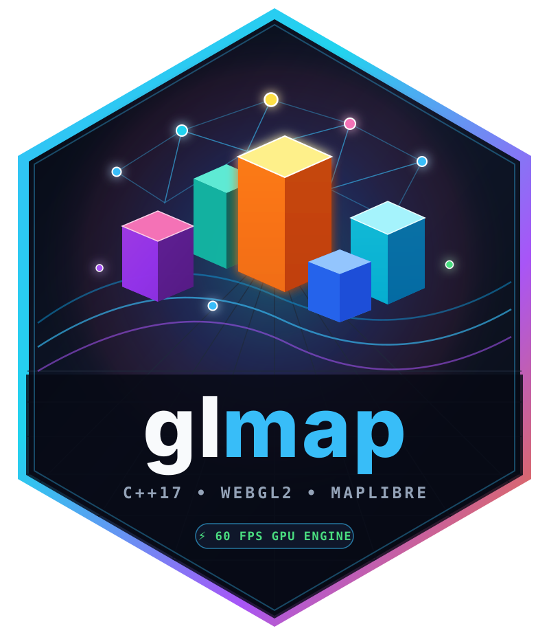

# `glmap` 

<!-- badges: start -->
[](https://lifecycle.r-lib.org/articles/stages.html#stable)
[](https://isocpp.org/)
[](https://maplibre.org/)
[](https://github.com/meztez/glmap/actions/workflows/R-CMD-check.yaml)
[](https://meztez.github.io/glmap/)
<!-- badges: end -->

**High-Performance GPU Geospatial Mapping for R (`sf`, `terra`, `wk`, `nanoarrow`, `DuckDB`, `Shiny`, `Quarto`)**

`glmap` is a compact, next-generation WebGL2 + **MapLibre GL** interactive mapping package for R built to replace `leaflet` for modern geospatial workflows (`sf`, `terra`, `wk`, `nanoarrow`, `shiny`, and `crosstalk`).

<div class="glmap-eli5-box">
<span class="glmap-box-badge">🌱 ELI5 Mode (Plain English)</span><br/>
<b>Why does <code>leaflet</code> freeze when you plot a big dataset, and how does <code>glmap</code> fix it?</b><br/>
Think of <code>leaflet</code> like writing down 1,000,000 phone numbers by hand on a giant paper scroll (GeoJSON text) and mailing it to your web browser, which then has to tape 1,000,000 paper stickers onto the screen one by one. Around 50,000 stickers, your browser runs out of breath and freezes.<br/><br/>
<b><code>glmap</code> skips the paper scroll completely:</b> C++ packs your numbers into a tiny zip-like binary block in a fraction of a second and hands it straight to your computer's <b>graphics card (GPU)</b>—the same chip used for 3D video games. Your graphics card draws all 1,000,000 points or raster cells at once at <b>60 frames per second</b>!
</div>

<div class="glmap-tech-box">
<span class="glmap-box-badge">⚙️ Technical Mode (Architecture Deep Dive)</span><br/>
<b>Zero-JSON Binary Transport & WebGL2 Shader Pipeline:</b><br/>
Where <code>leaflet</code> serializes R objects into verbose GeoJSON strings inside HTML via <code>jsonlite</code> and renders via DOM/SVG/2D Canvas, <code>glmap</code> extracts coordinates in <b>C++17</b> (<code>cpp11</code>), runs <code>mapbox/earcut.h</code> polygon hole triangulation in native code, and emits packed 48-byte aligned <code>GLMP</code> (vector) and <code>GLMR</code> (<code>Float32</code> raster) binary packets. Buffers are either compressed via RFC 1950 <code>zlib</code> (decoded in ~5 ms in-browser via native <code>DecompressionStream("deflate")</code>) or streamed via <code>httpuv</code> HTTP Range / viewport slices directly into WebGL2 Vertex Buffer Objects (VBOs) and <code>RGBA32F</code> floating-point textures.
</div>

---

## 1. Performance & Architecture Comparison: `glmap` vs. `leaflet`

| Dimension | `leaflet` (R Package) | `glmap` (C++17 + WebGL2 + MapLibre GL) |
| :--- | :--- | :--- |
| **Rendering Engine** | Leaflet.js (2D DOM / SVG / Canvas) | **MapLibre GL JS** + **Custom WebGL2 Shaders** (60 FPS GPU) |
| **R-to-Browser Data Transfer** | GeoJSON text embedded in HTML (`jsonlite`) | **Zero-JSON `GLMP` / `GLMR` Binary Buffers** (`zlib` stream or `httpuv` Range server) |
| **1,000,000 Points** | ~18–45 sec R serialization, >180 MB HTML, tab crash | **0.05 sec** in C++17 (19.07 MB raw / ~5 MB compressed), 60 FPS |
| **Polygon Triangulation** | Single-threaded JS `earcut` on browser main thread | **Pre-triangulated in C++17 (`mapbox/earcut.hpp`)** before reaching browser |
| **1,000,000 Point Hexbinning** | Requires external R pre-aggregation (`sf::st_make_grid`) | **0.10 sec** native C++17 64-bit spatial hash (`add_hexbin()`) |
| **`terra::SpatRaster` Rendering** | Re-projects & encodes static PNG in R on every change | **Raw `Float32` GPU Texture (`RGBA32F`)**: **0 ms** live colormap, hillshade, & band math |
| **Hover Pixel Inspection** | Not natively supported on rasters without server roundtrip | **O(1) in-memory `Float32Array` readout** at cursor (`Lon/Lat` + exact cell value) |
| **Out-of-Core / 10M+ Features** | Not supported | **Native `DuckDB` / Parquet SQL Pushdown (`add_duckdb()`)** + **C++17 R-Tree Index** |
| **Color Mapping** | Manual `colorNumeric()` / `colorFactor()` boilerplate | **Direct `~column` formula or string** with 256-entry C/R LUT & automatic legend |

---

## 2. Quick Start (Onboarding in 60 Seconds)

### One-Liner Auto-Detection
Pass any `sf`, `sfc`, `terra::SpatRaster`, `terra::SpatVector`, `wk::xy`, `nanoarrow_array`, `stars`, `data.frame`, or `crosstalk::SharedData` directly to `glmap()`:

```r
library(glmap)

# Generate synthetic benchmark data (200k points, 3k polygons, 250x250 Float32 DEM)
bench <- gl_benchmark_data(n_points = 200000L, n_polygons = 3000L)

# Instant one-line GPU map (auto-detects geometry or raster type)
glmap(bench$polygons_sf, fill_color = ~elevation, palette = "viridis")
```

### Multi-Layer Pipeable Workflow (`|>`)
```r
glmap(basemap = "dark") |>
  add_raster(
    bench$raster_mat,
    palette = "terrain",
    hillshade = TRUE,
    opacity = 0.65,
    group = "GPU Terrain DEM (Float32)"
  ) |>
  add_polygons(
    bench$polygons_sf,
    fill_color = ~elevation,
    palette = "viridis",
    fill_opacity = 0.65,
    group = "C++ Earcut Polygons (3k)"
  ) |>
  add_hexbin(
    bench$points_df,
    hex_radius = 0.035,
    palette = "plasma",
    opacity = 0.75,
    group = "C++ Hexbin Aggregation"
  ) |>
  add_points(
    bench$points_df,
    color = ~intensity,
    palette = "turbo",
    radius = 3.0,
    opacity = 0.85,
    group = "GPU Instanced Points (200k)"
  ) |>
  use_plugin("export_png")
```

---

## 3. Transitioning from `leaflet` to `glmap` (Human & Agent Cheat Sheet)

### Side-by-Side Translation Table

| Task | `leaflet` Code | `glmap` Equivalent |
| :--- | :--- | :--- |
| **Initialize Map** | `leaflet(data) |> addProviderTiles("CartoDB.DarkMatter")` | `glmap(data, basemap = "dark")` |
| **Basemap Switch** | `addProviderTiles("CartoDB.Positron")` | `set_basemap("positron")` (`"dark"`, `"voyager"`, `"osm"`, `"satellite"`) |
| **Add Points** | `addCircleMarkers(lng = ~lon, lat = ~lat, color = ~pal(val), radius = 5)` | `add_points(lon = ~lon, lat = ~lat, color = ~val, palette = "viridis", radius = 5)` |
| **Add Lines** | `addPolylines(color = "#38bdf8", weight = 2)` | `add_lines(color = "#38bdf8", width = 2)` |
| **Add Polygons** | `addPolygons(fillColor = ~pal(elev), fillOpacity = 0.7, weight = 1)` | `add_polygons(fill_color = ~elev, palette = "viridis", fill_opacity = 0.7, line_width = 1)` |
| **Add Raster (`terra`)** | `addRasterImage(r, colors = "terrain")` | `add_raster(r, palette = "terrain", hillshade = TRUE)` |
| **Add Legend** | `addLegend(pal = pal, values = ~val, title = "Val")` | **Automatic!** (Or customize via `add_legend()`) |
| **Set Camera View** | `setView(lng = -73.56, lat = 45.50, zoom = 10)` | `set_view(lng = -73.56, lat = 45.50, zoom = 10, pitch = 0)` |
| **Fit Bounding Box** | `fitBounds(xmin, ymin, xmax, ymax)` | `fit_bounds(c(xmin, ymin, xmax, ymax))` (or pass `sf` / `SpatRaster` directly) |
| **Shiny UI / Server** | `leafletOutput("map")` / `renderLeaflet({...})` | `glmapOutput("map")` / `renderGlmap({...})` |
| **Shiny Live Proxy** | `leafletProxy("map") |> clearGroup("pts")` | `glmap_proxy("map") |> clear_layer("pts")` |
| **Out-of-Core DuckDB / Parquet** | *(Not available)* | `add_duckdb(con, "sensors.parquet", color = ~val, where = "val > 50")` |
| **Save Standalone HTML** | `htmlwidgets::saveWidget(m, "map.html")` | `gl_save_html(m, "map.html")` |

### Before & After Code Comparison

**Before (`leaflet` — verbose palette setup, slow on >50k rows):**
```r
library(leaflet)

pal <- colorNumeric(palette = "viridis", domain = df$intensity)

leaflet(df) |>
  addProviderTiles(providers$CartoDB.DarkMatter) |>
  addCircleMarkers(
    lng = ~lon,
    lat = ~lat,
    color = ~pal(intensity),
    radius = 4,
    fillOpacity = 0.8,
    stroke = FALSE
  ) |>
  addLegend("bottomright", pal = pal, values = ~intensity, title = "Intensity")
```

**After (`glmap` — concise, automatic legend, 100x faster C++ binary -> WebGL2):**
```r
library(glmap)

glmap(df, basemap = "dark") |>
  add_points(color = ~intensity, palette = "viridis", radius = 4, opacity = 0.8, stroke = FALSE)
```

---

## 4. Shiny Integration & Zero-Copy Proxy Updates

In Shiny applications, `glmap_proxy()` updates existing GPU layers in-place without re-creating the basemap or re-uploading unchanged buffers:

```r
library(shiny)
library(glmap)

bench <- gl_benchmark_data(n_points = 100000L)

ui <- fluidPage(
  selectInput("pal", "Raster GPU Palette:", choices = c("terrain", "viridis", "magma", "turbo", "rdylbu")),
  checkboxInput("hill", "GPU Hillshade", value = TRUE),
  glmapOutput("map", height = "650px")
)

server <- function(input, output, session) {
  output$map <- renderGlmap({
    glmap(basemap = "dark") |>
      add_raster(bench$raster_mat, id = "dem", palette = "terrain", hillshade = TRUE) |>
      add_points(bench$points_df, id = "pts", color = ~intensity, palette = "plasma")
  })

  # 0ms GPU uniform update — does NOT re-send raster data!
  observeEvent(list(input$pal, input$hill), {
    glmap_proxy("map") |>
      set_raster_style("dem", palette = input$pal, hillshade = input$hill)
  }, ignoreInit = TRUE)

  # React to map clicks, viewport bounds, and box-brush selections
  observeEvent(input$map_click, {
    message("Clicked at: ", input$map_click$lng, ", ", input$map_click$lat,
            " | Raster value: ", input$map_click$raster_value)
  })

  observeEvent(input$map_selected, {
    message("Brushed ", input$map_selected$count, " features!")
  })
}
```

### Shiny Input Events Emitted Automatically by `glmap`
For a widget with `outputId = "map"`, `glmap` automatically provides:
- `input$map_click`: `list(lng, lat, raster_value)` on map click.
- `input$map_bounds`: `list(west, south, east, north)` after every pan/zoom (`moveend`).
- `input$map_selected`: `list(bbox, count, indices)` when the user drags a selection with the **Box Brush** tool.

---

## 5. Extension & Plugin Ecosystem (`register_plugin()`, Custom Shaders, Deck.gl)

`glmap` is designed to be extended by third-party packages (`glmap.extras`, internal organizational packages, etc.) via three levels:

1. **Level 1 — JS/CSS Plugin Registry (`register_plugin()` & `use_plugin()`)**:
   ```r
   register_plugin(
     name = "watermark",
     css = ".gl-wm { position:absolute; top:12px; left:50%; transform:translateX(-50%); color:#38bdf8; z-index:15; font-weight:700; }",
     js_init = "function(instance, config) {
       const div = document.createElement('div');
       div.className = 'gl-wm';
       div.textContent = config.text || 'CONFIDENTIAL';
       instance.el.appendChild(div);
     }",
     default_config = list(text = "Live Sensor Feed")
   )

   glmap(bench$points_df) |> use_plugin("watermark", config = list(text = "Live Sensor Feed"))
   ```
   Built-in plugins ready out of the box: `"measure"`, `"lasso_select"`, `"minimap"`, `"export_png"`.
2. **Level 2 — Custom WebGL2 GLSL Shaders (`add_webgl_shader_layer()`)**:
   Pass custom vertex and fragment shader GLSL strings directly from R while leveraging `glmap`'s C++17 `GLMP` binary vertex/attribute buffers.
3. **Level 3 — Custom Deck.gl Layer Bridge (`add_deck_layer()`)**:
   Dispatch arbitrary `deck.gl` layer specifications backed by binary buffers.

---

## 6. Ready-to-Run Examples (Quarto, Shiny & Showcase)

The package ships with three complete, runnable examples in `inst/examples/`:

1. **Interactive Multi-Layer GPU Showcase**:
   ```r
   source(system.file("examples/showcase.R", package = "glmap"))
   ```
2. **Full Shiny Dashboard App (`glmap_proxy`, 0ms GPU Raster Shader, Group Controls & Live Telemetry)**:
   ```r
   shiny::runApp(system.file("examples/shiny_app", package = "glmap"))
   ```
3. **Self-Contained Quarto Document (`quarto_report.qmd`)**:
   ```r
   file.edit(system.file("examples/quarto_report.qmd", package = "glmap"))
   # Render via: quarto render inst/examples/quarto_report.qmd
   ```
4. **Full Documentation & Learning Path (`https://meztez.github.io/glmap/articles/`)**:
   - `vignette("getting-started", package = "glmap")` — Quick start & GPU mental model
   - `vignette("basemaps-and-projections", package = "glmap")` — 1. Map Widget, Basemaps & Projections
   - `vignette("markers-and-clusters", package = "glmap")` — 2. Markers, GPU Icon Atlases, Clustering & Spiderfy
   - `vignette("shapes-and-choropleths", package = "glmap")` — 3. Lines, Polygons (`earstrip`), Choropleths & Geodesic Shapes
   - `vignette("raster-hexbin-duckdb", package = "glmap")` — 4. GPU Rasters (`Float32`), Hexbins, Heatmaps & Out-of-Core DuckDB
   - `vignette("controls-shiny-and-export", package = "glmap")` — 5. Layer Groups, 9-Zone Controls, Draw Tools, Shiny & Export
   - `vignette("legacy-leaflet-mapping", package = "glmap")` — Legacy `leaflet` Function Call Mapping & Zero-Rewrite Reuse
   - `vignette("leaflet-migration", package = "glmap")` — Migrating from `leaflet` to Idiomatic `glmap`
   - `vignette("benchmarks-and-leaflet-parity", package = "glmap")` — Real-Life Benchmarks & Complete Parity Matrix

---

## 7. Instructions for AI Coding Agents

---

## 8. Licensing & Bundled Open-Source Attributions

`glmap` is released under the permissive **MIT License** (`LICENSE`, `LICENSE.md`). All bundled third-party libraries use permissive, commercial- and CRAN-friendly open-source licenses with zero GPL/AGPL copyleft restrictions (full texts in [`inst/COPYRIGHTS`](./inst/COPYRIGHTS)):

| Component | Version | License | Copyright / Attribution |
| :--- | :--- | :--- | :--- |
| **`glmap` R / C++17 / JS Engine** | `1.0.0` | **MIT License** | Copyright (c) 2026 Bruno Tremblay and `glmap` authors |
| **MapLibre GL JS** (`inst/htmlwidgets/lib/maplibre-gl/`) | `4.7.1` | **BSD-3-Clause** | Copyright (c) 2020 MapLibre contributors; Copyright (c) 2014–2020 Mapbox, Inc. |
| **GLMap `earstrip.hpp`** (`src/earstrip.h`) | `1.0.0` | **ISC License** | Copyright (c) 2026 Evgen Bodunov |
| **Mapbox `earcut.hpp`** (`src/earcut.h`) | `2.2.4` | **ISC License** | Copyright (c) 2015 Mapbox |
| **Default Map Tiles** | — | **ODbL / CC-BY** | `© OpenStreetMap contributors`, `© CARTO`, `© OpenFreeMap` (rendered automatically in the bottom-right attribution control) |

